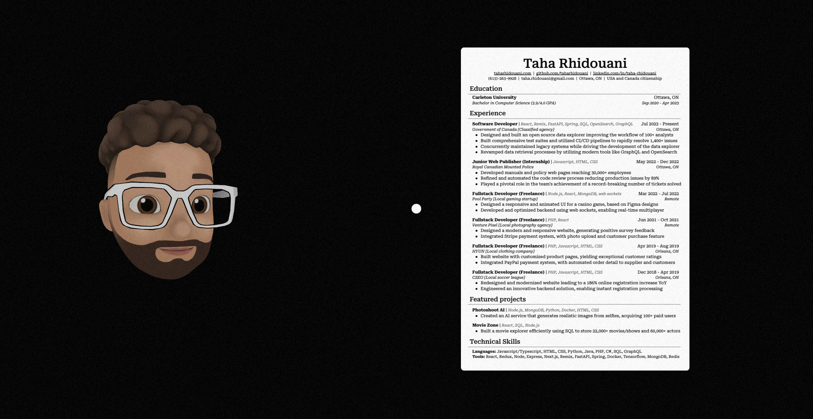
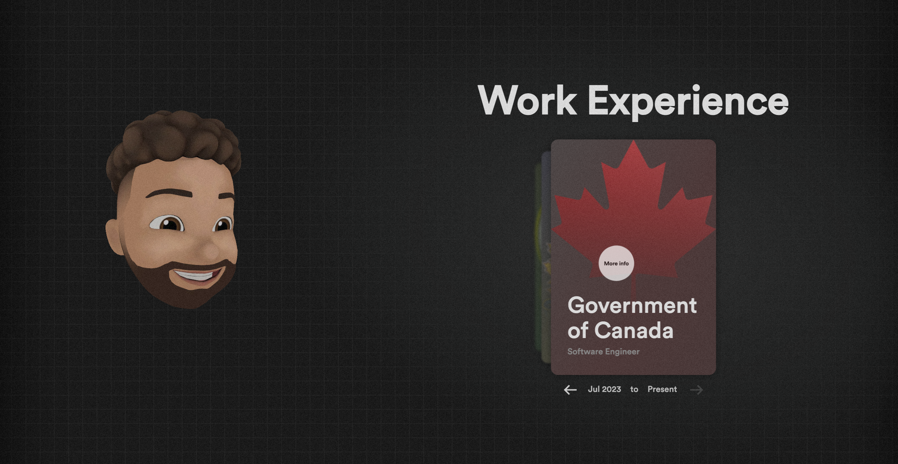
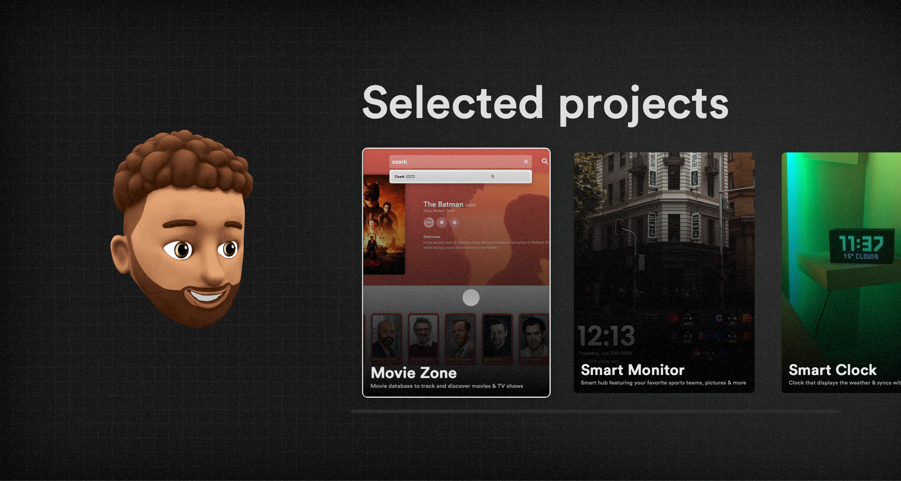
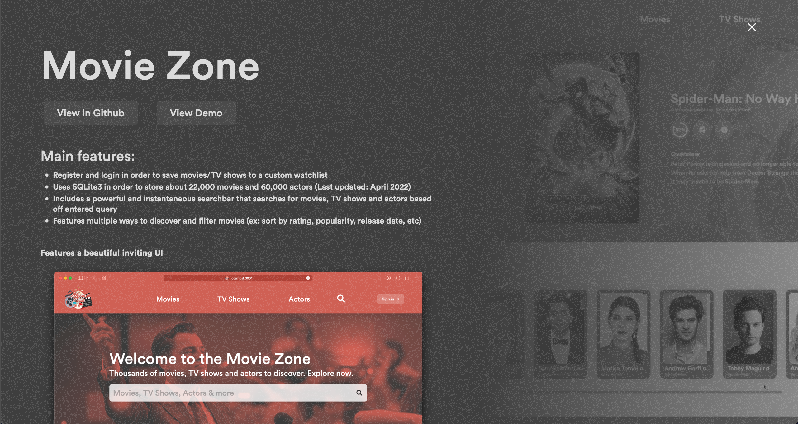
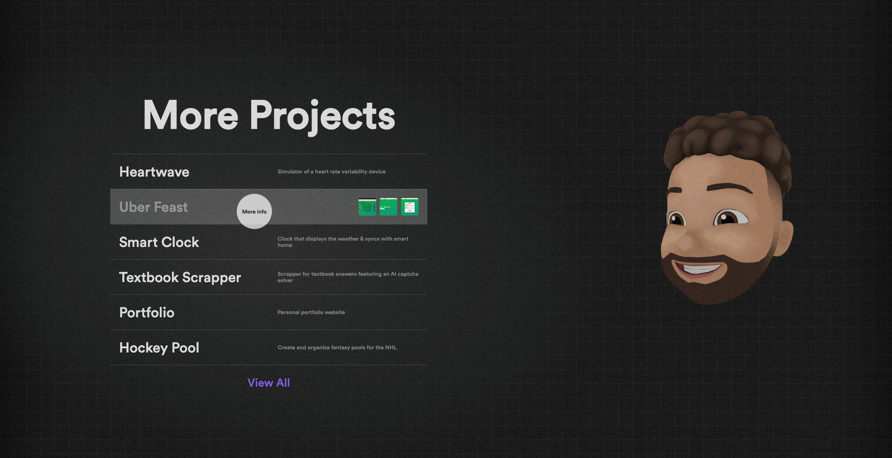
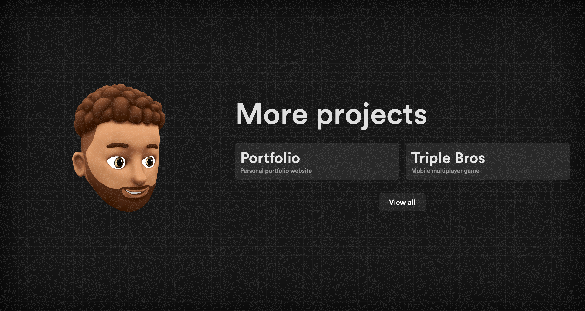

# Portfolio website

This is a personal portfolio website I made to showcase all my projects, work experience, achievements and socials.














## Run

Every push to `main` builds the image `ghcr.io/taharhidouani/portfolio` (tags `main` and `sha-<commit>`). The container listens on port 8080 and answers `GET /healthz`. Pages render on request, so the build needs no secrets.

| Variable | Purpose |
| --- | --- |
| `MONGODB_URI` | MongoDB connection string (database `portfolio`) |
| `URL` | Public site URL, for example `https://taharhidouani.com` |
| `NEXTAUTH_URL` | Public site URL, for example `https://taharhidouani.com` |
| `NEXTAUTH_SECRET` | Random string that signs dashboard sessions |
| `GITHUB_ID`, `GITHUB_SECRET` | GitHub OAuth app for the dashboard sign-in |
| `GITHUB_EMAIL` | The only GitHub account email allowed into the dashboard |
| `GITHUB_USERNAME`, `GITHUB_API` | GitHub account and token used to fetch projects |
| `GOOGLE_API_KEY` | Google Drive API key used to fetch the resume |

```sh
docker run -p 8080:8080 --env-file portfolio.env ghcr.io/taharhidouani/portfolio:main
```

All content lives in MongoDB; the container writes nothing that needs to persist.
